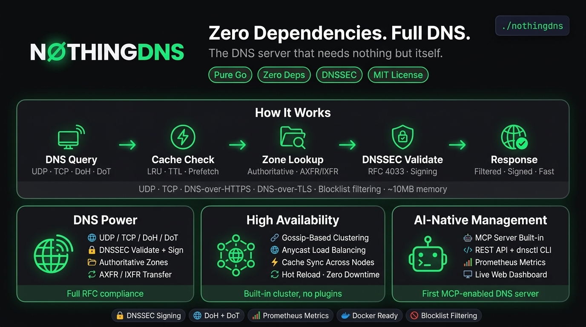

# NothingDNS

<p align="center">
  
</p>

[](https://golang.org)
[](LICENSE)
[](https://goreportcard.com/report/github.com/nothingdns/nothingdns)
[](https://github.com/NothingDNS/NothingDNS/releases)
[](https://github.com/NothingDNS/NothingDNS/actions/workflows/go.yml)

NothingDNS is a self-contained DNS server written in Go. It includes authoritative DNS, recursive forwarding/resolution, DNSSEC, encrypted transports, policy filtering, clustering, a REST management API, `dnsctl`, and an embedded React dashboard.

**Contents:** [What is included](#what-is-included) · [Quick start](#quick-start) · [Transports and ports](#transports-and-ports) · [How a query is answered](#how-a-query-is-answered) · [Managing the server](#managing-the-server) · [Clustering](#clustering) · [Design principles](#design-principles) · [Repository map](#repository-map) · [Documentation](#documentation) · [Development](#development)

## What is included

- **DNS serving**: UDP/TCP DNS, authoritative zones (with an answer cache), forwarding, iterative resolution, DNS64, SVCB/HTTPS, IDNA, QNAME minimization, and RFC 6761 special-use names.
- **Security and policy**: DNSSEC validation/signing, DNS Cookies, DoH, DoT, DoQ, ODoH, DSO, ACLs, a recursion allow list (authoritative answers for everyone, recursion only for trusted networks), RRL, RPZ, and blocklists from hosts-style, URL, or plain domain-per-line sources.
- **Operations**: hot reload (SIGHUP or `POST /api/v1/config/reload`; see the matrix in [docs/CONFIG_REFERENCE.md](docs/CONFIG_REFERENCE.md)), Prometheus metrics, structured audit logs, memory protection, systemd/Docker/Kubernetes deployment assets, and backup/health-check scripts.
- **Management**: REST API with OpenAPI/Swagger, `dnsctl`, and an embedded React 19 dashboard with WebSocket query streaming, zone management, user and password management, and ACL editing.
- **Zone transfer and updates**: AXFR/IXFR, NOTIFY, TSIG-signed Dynamic DNS (RFC 2136), XoT (RFC 9103), slave zones that survive restarts, and SOA editing from the dashboard and API.
- **Persistence and HA**: built-in KV/WAL storage, split-horizon views, GeoIP responses, and gossip/Raft clustering.
- **Client SDKs**: management API clients for Go, Python, TypeScript, Java, and C# under [`sdk/`](sdk/README.md).

## Quick start

```bash
# Build the server and CLI with Go 1.26.9+
make build

# Run using the example configuration
go run ./cmd/nothingdns --config config.example.yaml

# Build the embedded web dashboard when frontend assets change
make build-web

# Validate a configuration without starting the server
./nothingdns --config config.example.yaml -validate-config

# Run the short test suite
go test ./... -count=1 -short
```

Then try it (use a port such as 5354 if you cannot bind port 53):

```bash
dig @127.0.0.1 example.com A
dnsctl zone list                      # talks to the API on http://localhost:8080
```

On a fresh install, create the dashboard admin from the local machine (the bootstrap endpoint only accepts localhost; the password is read from stdin):

```bash
dnsctl server bootstrap --username admin
```

Install scripts are available for packaged/binary-style setups:

```bash
# Linux/macOS
curl -fsSL https://raw.githubusercontent.com/NothingDNS/NothingDNS/main/install.sh | bash

# Windows PowerShell as Administrator
irm https://raw.githubusercontent.com/NothingDNS/NothingDNS/main/install.ps1 | iex
```

For Docker and Kubernetes examples, see [QUICK_START.md](QUICK_START.md) and [docs/OPERATIONS.md](docs/OPERATIONS.md).

> **Docker / GHCR:** The container image is public and can be pulled without
> authentication: `docker pull ghcr.io/nothingdns/nothingdns:latest`.

## Transports and ports

Every listener is optional and configured in [config.example.yaml](config.example.yaml); the ports below are the defaults used there and in the container image.

| Transport | Default | Config |
|---|---|---|
| DNS over UDP / TCP | `53` | `server.port`, `server.bind` |
| DNS over TLS (DoT) | `853/tcp` | `server.tls` |
| DNS over QUIC (DoQ) | `853/udp` | `server.quic` |
| Zone transfer over TLS (XoT, RFC 9103) | `853/tcp` (deny-by-default) | `server.xot` |
| DNS over HTTPS (DoH, RFC 8484) | `/dns-query` on the API listener | `server.http.doh_enabled` |
| Oblivious DoH (RFC 9230) | `/odoh` on the API listener | `server.http.odoh_enabled` |
| DNS over WebSocket (DoWS) | `/dns-ws` on the API listener | `server.http.dows_enabled` |
| DNS Stateful Operations (DSO, RFC 8490) | keepalive sessions on TCP / DoT | `server.tls` |
| REST API, dashboard, WebSocket stream | `8080` | `server.http` |
| Prometheus metrics | `9153` (loopback unless configured) | `metrics` |
| Cluster gossip / Raft RPC | `7946` | `cluster` |

## How a query is answered

```
UDP │ TCP │ DoT │ DoH │ DoQ │ ODoH
              ▼
 ACL → recursion policy → RPZ → rate limit → cookies
              ▼
 ANY / AXFR / IXFR / NOTIFY / UPDATE handling
              ▼
 blocklist → local zones (split-horizon, CNAME chasing, special-use names)
              ▼
 cache → iterative resolver or upstream forwarding → DNSSEC validation
```

Local zones are consulted before the caches, so cached upstream data can never shadow a zone you serve. Clients outside the `allow_recursion` list still get authoritative answers but are refused recursion. The full stage order is documented in [docs/ARCHITECTURE.md](docs/ARCHITECTURE.md) and [AGENTS.md](AGENTS.md).

## Managing the server

**CLI.** `dnsctl` covers zones, records, cache, cluster, blocklists, config, DNSSEC and a built-in `dig`:

```bash
dnsctl zone add example.com
dnsctl record add example.com www A 192.0.2.10
dnsctl cache stats
dnsctl dig @127.0.0.1 www.example.com A
dnsctl dnssec                         # DNSSEC key and signing operations
```

Global flags (`-server`, `-api-key`) and the `NOTHINGDNS_SERVER` / `NOTHINGDNS_API_KEY` variables are described in [docs/CLI_REFERENCE.md](docs/CLI_REFERENCE.md).

**REST API.** The OpenAPI document is served at `/api/openapi.json` on every node; see [docs/API_REFERENCE.md](docs/API_REFERENCE.md). The client SDKs in [`sdk/`](sdk/README.md) wrap the same operations.

**Dashboard.** The React dashboard is embedded in the binary and served from the API listener: live query stream, zones and SOA editor, cache, ACL and recursion allow list, users, and cluster topology.

**Hot reload.** `SIGHUP` or `POST /api/v1/config/reload` re-reads the config. Everything is prepared first, so a bad config or zone file aborts the reload and leaves the running state untouched. Check a file beforehand with `nothingdns --config FILE -validate-config`. TLS certificates are re-read on every reload. Settings that need a restart are listed in [docs/CONFIG_REFERENCE.md](docs/CONFIG_REFERENCE.md).

## Clustering

Nodes find each other with SWIM-style gossip (AES-256-GCM encrypted) and can replicate zone data through Raft consensus, with optional mutual TLS on the Raft RPC. In Raft mode, dynamic updates received by a follower can be forwarded to the leader. Example three-node configs live in `deploy/config-node{1,2,3}.yaml`. Mixed-version clusters have caveats; see the upgrade table in [docs/SPECIFICATION.md](docs/SPECIFICATION.md) §10.4 before a rolling upgrade.

## Design principles

- **Small dependency surface.** The DNS protocol, YAML parser, storage engine, clustering, DNSSEC, HPKE/ODoH and the rest are written on the Go standard library. Direct dependencies are limited to `quic-go` (DoQ), `golang.org/x/sys` and the OpenTelemetry SDK; see [docs/DEPENDENCIES.md](docs/DEPENDENCIES.md).
- **Static, single binary.** Built with `CGO_ENABLED=0`; the container image is built `FROM scratch`.
- **Strict configuration.** Unknown ACL types, bad booleans, tab indentation and unservable zone records are load errors rather than silent defaults.
- **Bounded DNSSEC work.** Validator limits are fixed constants to resist KeyTrap-style attacks (CVE-2023-50387, CVE-2023-50868).
- **Runtime state lives beside the config.** Users, ACL changes and no-restart tunables made through the API or dashboard are persisted under `storage.data_dir` and win over the YAML; see [docs/CONFIG_REFERENCE.md](docs/CONFIG_REFERENCE.md).

## Repository map

| Path | Purpose |
|---|---|
| `cmd/nothingdns/` | Server entry point and runtime wiring |
| `cmd/dnsctl/` | Management CLI |
| `internal/` | DNS protocol, resolver, API, DNSSEC, storage, clustering, transports, and support packages |
| `web/` | React dashboard source and build tooling |
| `internal/dashboard/static/dist/` | Embedded dashboard build output served by the Go binary |
| `deploy/` | systemd, Docker/Kubernetes, and Helm deployment assets |
| `docs/` | Architecture, configuration, operations, API, CLI, testing, performance, and release documentation |
| `examples/` | Example-oriented documentation |
| `sdk/` | Management API client libraries (Go, Python, TypeScript, Java, C#) |
| `scripts/` | Development, smoke-test, backup, and health-check helpers |

Generated runtime state and local build artifacts such as `nothingdns`, `dnsctl`, `bin/`, `logs/`, `zones/`, `clusters/`, `*.db`, and `cache.json` are intentionally ignored.

## Documentation

Start with the [documentation index](docs/README.md). Common entry points:

| Need | Document |
|---|---|
| Configuration fields and defaults | [docs/CONFIG_REFERENCE.md](docs/CONFIG_REFERENCE.md) |
| Operations, deployment, backup, monitoring | [docs/OPERATIONS.md](docs/OPERATIONS.md) |
| REST API endpoints | [docs/API_REFERENCE.md](docs/API_REFERENCE.md) |
| Zone API details | [docs/API_ZONES.md](docs/API_ZONES.md) |
| `dnsctl` commands | [docs/CLI_REFERENCE.md](docs/CLI_REFERENCE.md) |
| Architecture and request pipeline | [docs/ARCHITECTURE.md](docs/ARCHITECTURE.md) |
| Implementation notes | [docs/IMPLEMENTATION.md](docs/IMPLEMENTATION.md) |
| Testing and fuzzing | [docs/TESTING.md](docs/TESTING.md) |
| Performance tuning | [docs/PERFORMANCE.md](docs/PERFORMANCE.md) |
| Security policy | [SECURITY.md](SECURITY.md), [docs/SECURITY.md](docs/SECURITY.md) |
| Dependencies | [docs/DEPENDENCIES.md](docs/DEPENDENCIES.md) |
| Release history | [docs/CHANGELOG.md](docs/CHANGELOG.md) |
| Troubleshooting | [docs/TROUBLESHOOTING.md](docs/TROUBLESHOOTING.md) |

## Development

```bash
make build        # server + dnsctl
make build-web    # dashboard bundle
make test         # short Go tests
make test-full    # full Go tests
make lint         # go vet + gofmt check
make staticcheck  # staticcheck
make clean        # remove local binaries and coverage files
```

CI does not run on push or PR: the workflows run only when triggered manually (`gh workflow run go.yml --ref main`) or on a `v*` tag push. Run `go vet`, `staticcheck`, `errcheck`, `go-errorlint` and `govulncheck` locally before pushing; see [docs/TESTING.md](docs/TESTING.md).

The web package uses npm scripts:

```bash
cd web
npm install
npm run build
npm test          # unit tests with Vitest + React Testing Library
npm run lint
```

## Configuration

Use [config.example.yaml](config.example.yaml) as the source-aligned example configuration. The full schema and hot-reload behavior are documented in [docs/CONFIG_REFERENCE.md](docs/CONFIG_REFERENCE.md).

## Contributing and license

Contributions are welcome; see [CONTRIBUTING.md](CONTRIBUTING.md). NothingDNS is released under the [MIT License](LICENSE).
